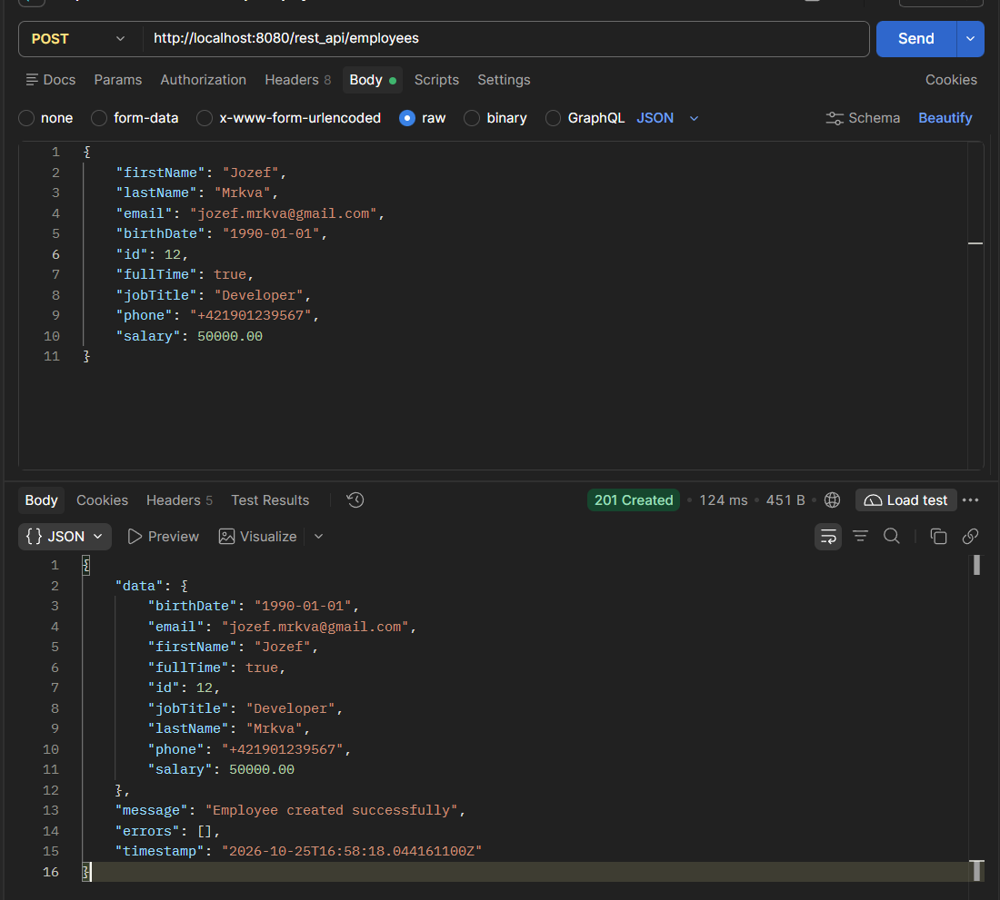
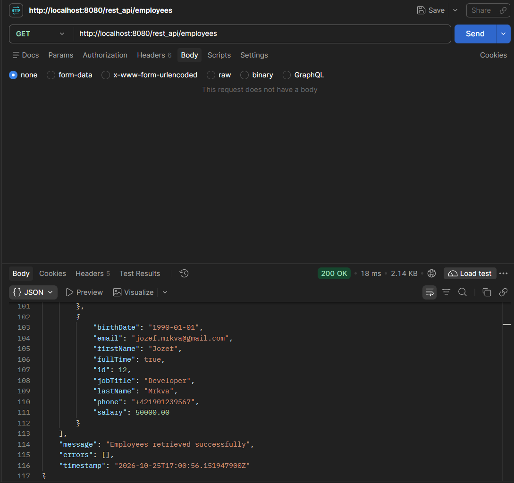
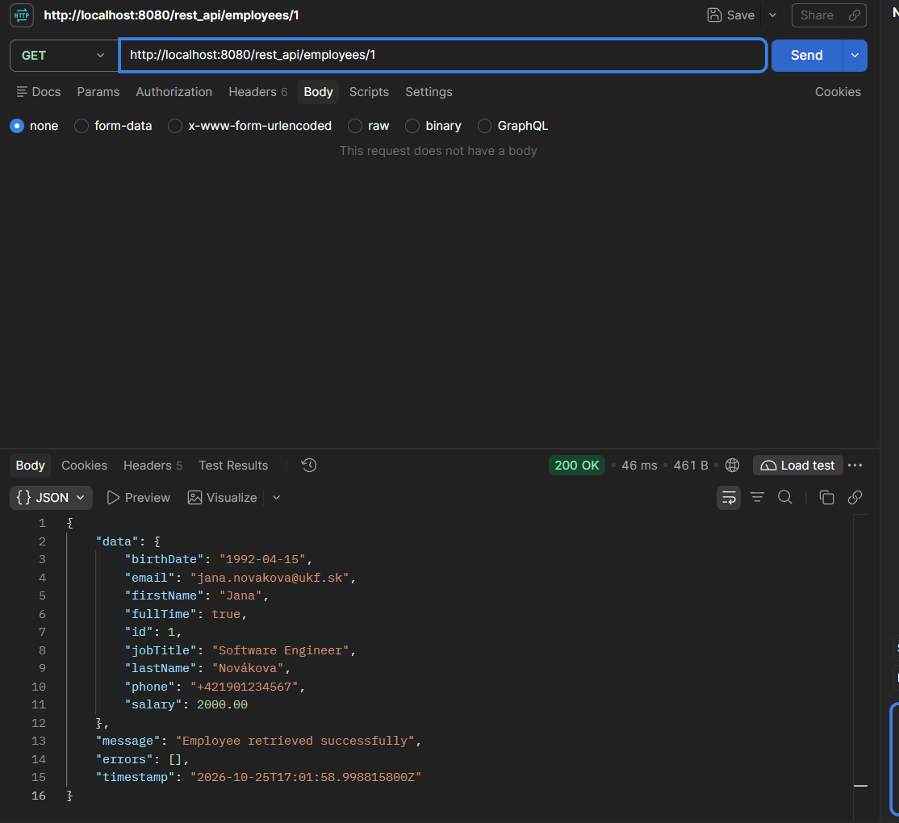
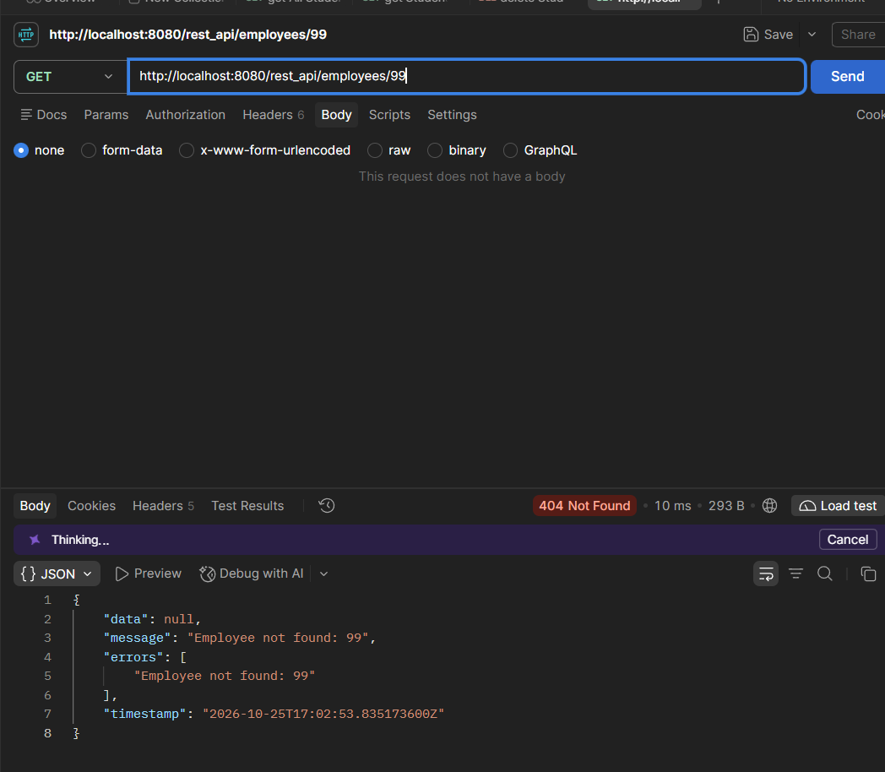
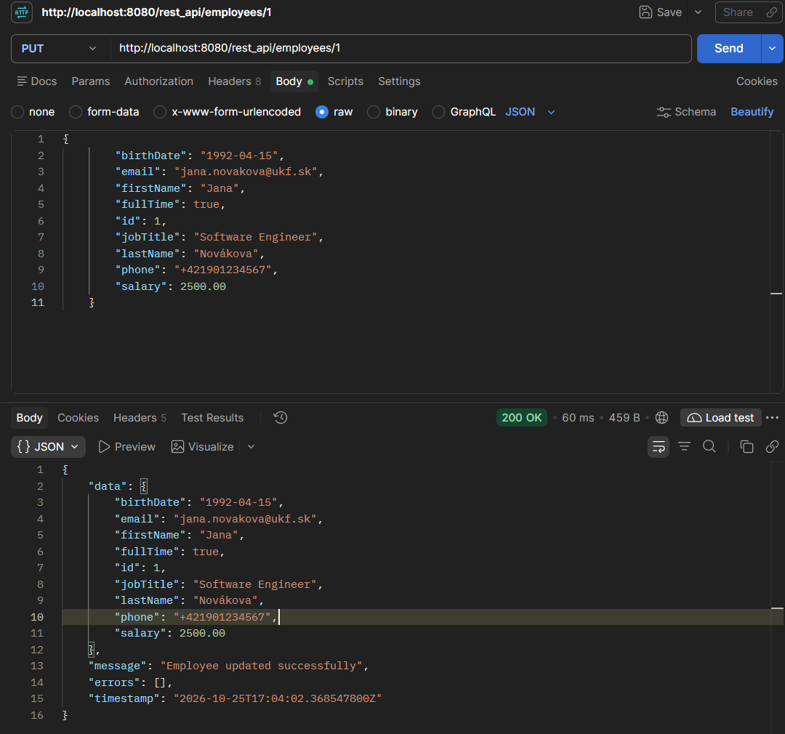
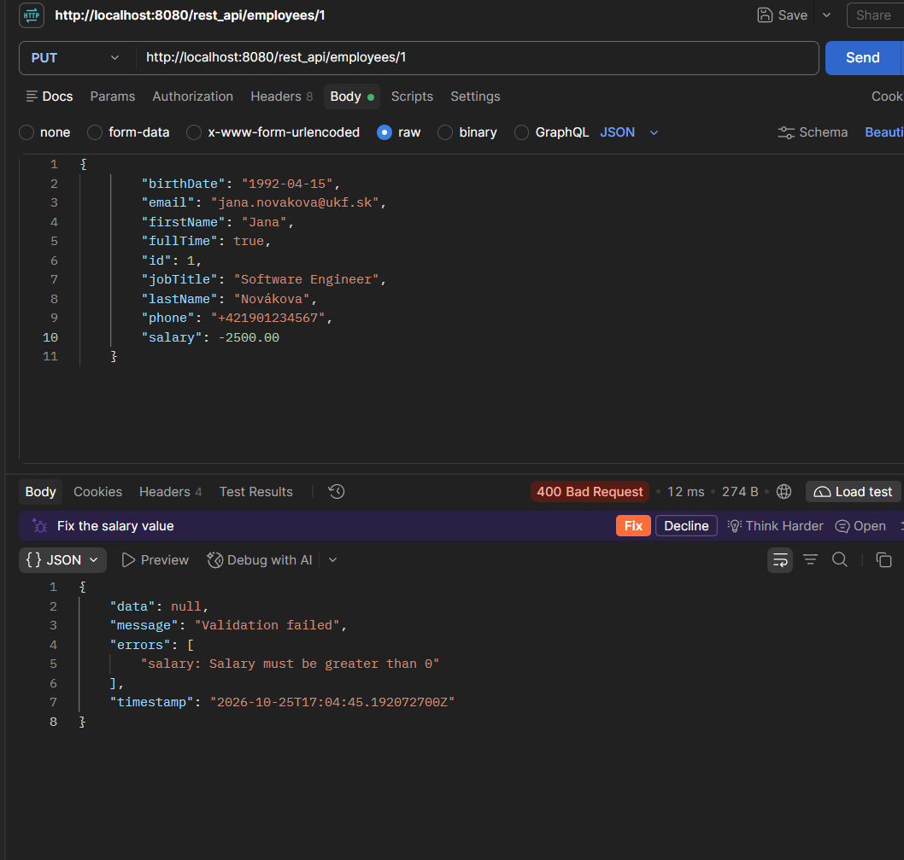
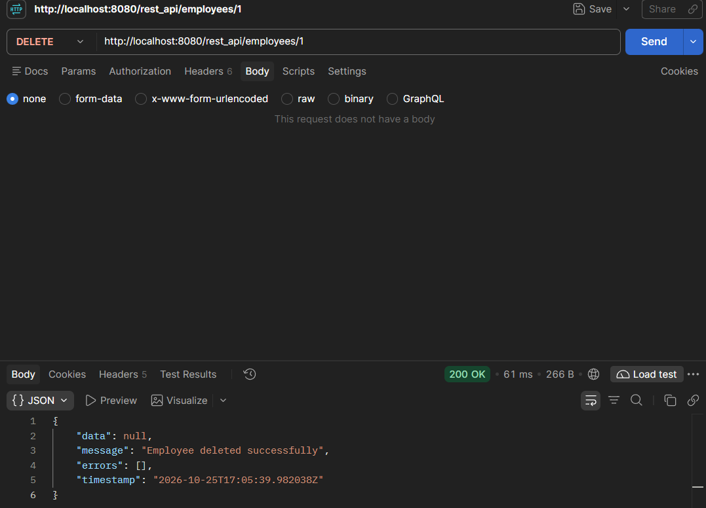
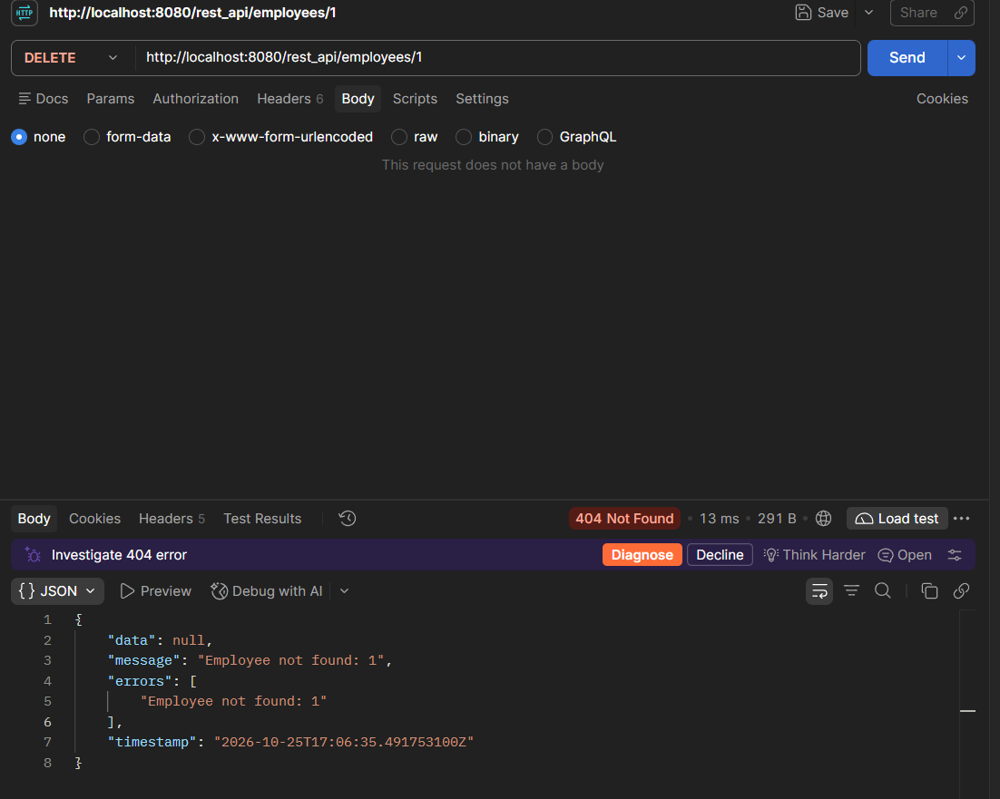

Get request to `http://localhost:8080/rest_api/employees`:

**GET** Get 1 employee Endpoint: `http://localhost:8080/rest_api/employees/1`:

**GET** Get all empoloyees Endpoint: `http://localhost:8080/rest_api/employees` in Postaman:

**PUT** Update existing empolyee Endpoint: `http://localhost:8080/rest_api/employees/1`:

**POST** Create new employee Endpoint: `http://localhost:8080/rest_api/employees`:

**DELETE** Delete employee Endpoint: `http://localhost:8080/rest_api/employees/7`:

**POST** Create new employee  Endpoint `http://localhost:8080/rest_api/employees` in Postaman with massage:

**GET** Get all empoloyees Endpoint: `http://localhost:8080/rest_api/employees` in Postaman with massage:

*GET** Get 1 employee Endpoint: `http://localhost:8080/rest_api/employees/1` in Postaman with massage:

And with wrong id:

**PUT** Update existing empolyee Endpoint: `http://localhost:8080/rest_api/employees/1` in Postaman with massage:

And with mistake:

**DELETE**  Delete employee Endpoint: `http://localhost:8080/rest_api/employees/1` in Postaman with massage:

And if we dont have employee with such id:

